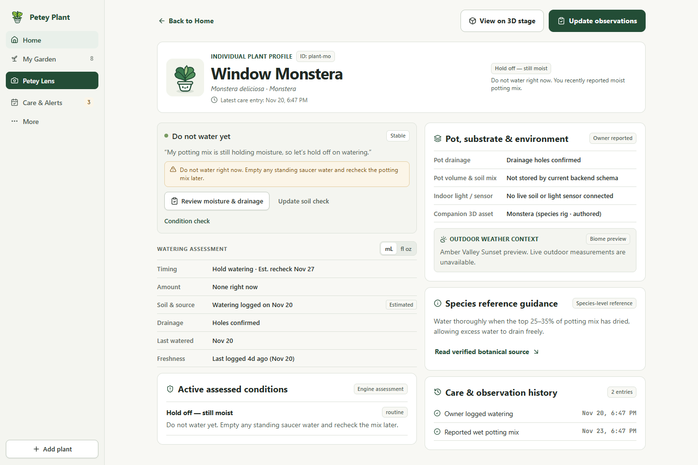
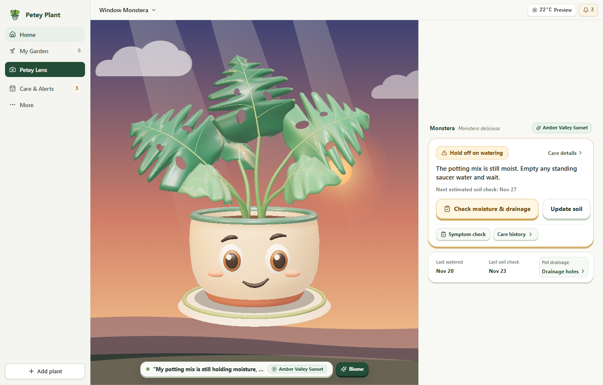
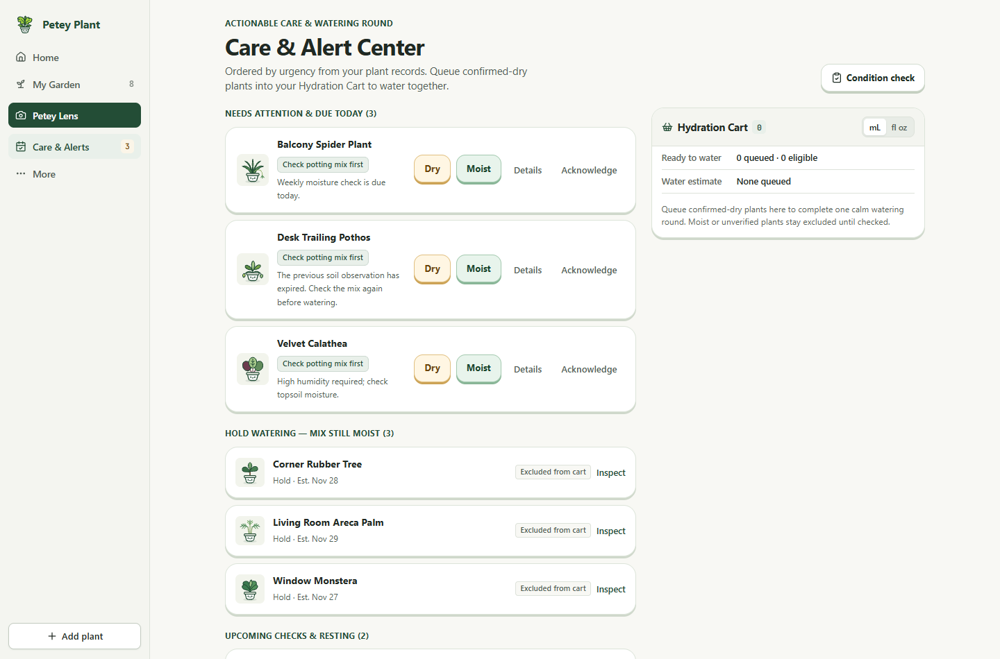
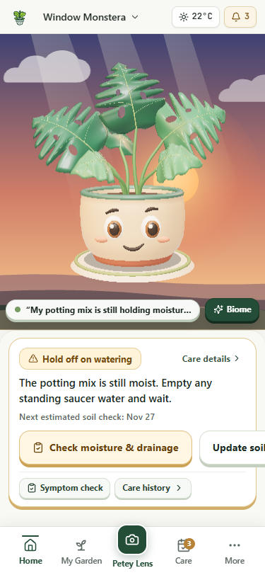

# Petey Plant 🌱

**An intelligent houseplant companion with living 3D botanical digital twins.** Petey helps busy people remember when to check the houseplants they already own, record what they observe, and get practical, evidence-backed care guidance. Eight flagship **Plant Pals** bring those observations to life with custom Blender 3D geometry, emotional expressions, and real-time animations in React Three Fiber.

[Walk through the workflows](docs/WORKFLOWS.md) · [Meet the 8 Plant Pals](docs/images/petey-live-plant-pals.png) · [Read the flight readiness report](docs/FLIGHT_READINESS_REPORT.md)

---


---

## What You Can Do Today

| Workflow | What is built and working in your local app |
|---|---|
| **🌱 My Garden** | Save houseplants from a verified catalog, monitor hydration, log care events, and receive observation-calibrated checkup dates. |
| **🪴 3D Plant Pals** | Meet eight living botanical companions authored in Blender 5.2. Each pal mirrors its real-world care state through dynamic expressions and interactive dance reactions. |
| **💧 Soil Checkup** | Step-by-step soil inspection flow that distinguishes surface dryness from deep moisture and provides source-cited watering instructions. |
| **🩺 Plant Health Triage** | Diagnostic symptom matcher evaluating yellowing, drooping, scorch, or pests against university extension knowledge bases. |
| **🔍 Petey Lens** | Camera capture and photo review pipeline with botanical trait comparison across leaf, stem, and margin shapes. |
| **🔬 Plant Lab** | Experimental biophysical digital twin simulating hourly Penman-Monteith transpiration, vapor pressure deficit (VPD), and root-rot emergency braking. |

---

## 🪴 Eight Living 3D Plant Pals

Petey includes eight flagship botanical companions, individually sculpted in Blender 5.2 and rendered in real-time with React Three Fiber and Three.js. Each companion has its own botanical archetype, personality trait, calibrated camera preset, and care responsiveness.


| Companion | Species | Botanical Persona | Key 3D Features |
|---|---|---|---|
| **Monstera** | *Monstera deliciosa* | The confident leader | Broad fenestrated leaves, aerial root stems, celebrate & sway animations |
| **Golden Pothos** | *Epipremnum aureum* | The friendly trailblazer | Trailing vines, heart-shaped variegated foliage, interactive dance loop |
| **Snake Plant** | *Dracaena trifasciata* | The steady guardian | Upright architectural spears, banded chlorophyll texture, drought postures |
| **Spider Plant** | *Chlorophytum comosum* | The caring multitasker | Arching variegated blades, runner offshoots, responsive light sensitivity |
| **Aloe Vera** | *Aloe vera* | The resourceful helper | Succulent rosette geometry, toothed leaf margins, arid hydration state |
| **Rubber Tree** | *Ficus elastica* | The ambitious believer | Glossy elliptical foliage, structural central trunk, burgundy apical sheaths |
| **Peacock Plant** | *Goeppertia makoyana* | The elegant diva | Intricate feather patterned calathea foliage, nyctinastic leaf folding |
| **Areca Palm** | *Dypsis lutescens* | The sunny socialite | Clustered bamboo-style canes, feathery arching fronds, gentle breeze sway |

---

## 📱 Interactive Workflows & UI Showcase

### 1. Plant Care Profile & 3D Companion Stage
Selecting any plant in your garden opens its dedicated **Plant Care Profile**. The interactive 3D stage allows you to inspect the plant from any angle, trigger dance animations, and view the complete chronological care ledger.



### 2. Multi-Step Soil Checkup & Care Guidance
Never guess whether to water. Petey guides you through physical observation questions (surface feel, inspection depth, saucer standing water) and only recommends watering when the physical evidence and drainage verify it is safe.



### 3. Plant Health & Symptom Triage
When foliage changes, the **Plant Health** triage assistant evaluates symptoms (chlorosis, tip burn, drooping, leaf spots) alongside current lighting, humidity, and substrate moisture to provide actionable, source-cited next steps.



### 4. Petey Lens Species Identification
Take a live photograph or upload a picture of a houseplant. Petey Lens strips metadata client-side, allows you to inspect the crop, and matches leaf venation and stem habits against the botanical catalog.


### 5. Plant Lab · Biophysical Digital Twin
Originated during the Meta Global AI Developer Hackathon, **Plant Lab** features a fully interactive 3D terrarium with biophysical sensor simulations, hourly transpiration modeling, vapor pressure deficit (VPD) charts, and the automated **Root Rot Emergency Brake**.


### 6. Responsive Mobile Greenhouse
Designed with rigorous 320px–1440px viewport discipline, Petey Plant runs seamlessly on mobile devices with touch navigation, tactile feedback, and accessible contrast ratios.

<p align="center">
  
</p>

---

## 🛠️ Architecture & Tech Stack

```
PeteyPlant/
├── assets/characters/         # Editable Blender 5.2 source files (.blend) and specs
├── backend/
│   ├── data/seed_10k_species  # Curated species database with university extension citations
│   ├── lens_pipeline/         # Offline model qualification & evaluation harness
│   ├── models/schemas.py      # Pydantic v2 data models
│   ├── services/              # ML vision, timeseries biophysics, and botanical engine
│   └── main.py                # FastAPI REST endpoints & local SQLite store
├── frontend/
│   ├── src/components/garden/ # GardenApp, 3D InteractivePlantStage, PalCharacter
│   ├── src/components/lab/    # PlantLab biophysical terrarium & sensor charts
│   ├── src/lib/three/         # Species asset registry & Three.js shaders
│   └── verification/          # Playwright test journeys & WCAG contrast audit
└── docs/                      # Architectural diagrams, workflows, and test reports
```

- **Frontend:** React 19, TypeScript, React Three Fiber (`@react-three/fiber`), Three.js (`three`), Tailwind CSS, Framer Motion, and Lucide React.
- **Backend:** FastAPI, Python 3.12+, Uvicorn, SQLite, Pydantic v2, and NumPy.
- **3D Art Pipeline:** Blender 5.2 master models with clean topological quads, baked PBR glTF/GLB exports, and non-destructive modifier stacks.
- **Verification:** Automated Playwright end-to-end user journeys, WCAG AA contrast audits, and SwiftShader headless visual rendering tests.

---

## 📖 Honest Disclosures & Data Provenance

- **Verified Qualitative Data:** 31 of the 79 catalog species carry rigorous, peer-reviewed qualitative care data directly cited to the Missouri Botanical Garden, ASPCA, NC State Extension, RHS, and UF/IFAS Extension.
- **Deterministic Offline Fallbacks:** No external neural network API calls are required at runtime. When optional cloud endpoints are unconfigured, Petey executes deterministic local fallbacks with exact response shapes and disclosed telemetry headers (`X-Muse-Fallback: true`).
- **Synthetic Lab Data:** The telemetry curves, sensor values, and historical walks in Plant Lab are clearly labeled synthetic simulations designed to stress-test biophysical equations.
- **Offline-First Security:** Petey stores plant records in local SQLite and browser storage. Photos uploaded in Petey Lens are processed strictly in-memory and are never retained or used as training data.

---

## 🚀 Quickstart Guide

### 1. Backend (FastAPI)

```bash
cd backend
python -m uvicorn main:app --port 8000
# API available at http://localhost:8000
# Interactive Swagger docs at http://localhost:8000/docs
```

### 2. Frontend (Vite + React)

```bash
cd frontend
npm ci
npm run dev      # Local dev server at http://localhost:3000
npm run build    # Production build into frontend/dist/
```

### 3. Verification & Visual Audits

```bash
# Run backend test suite (391 tests)
cd backend
python -m pytest -q

# Run frontend WCAG AA contrast audit
cd ../frontend
npm run verify:contrast

# Run visual verification screenshots
node tools/capture_showcase.mjs
```

---

## 📜 License & Acknowledgments

Petey Plant is licensed under the MIT License. See [LICENSE](LICENSE) for details. Special thanks to the extension horticultural programs at NC State, Missouri Botanical Garden, and RHS for published plant care methodologies.
