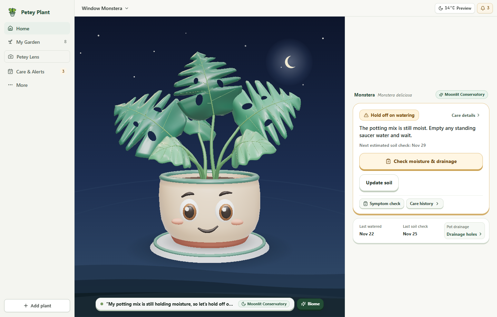
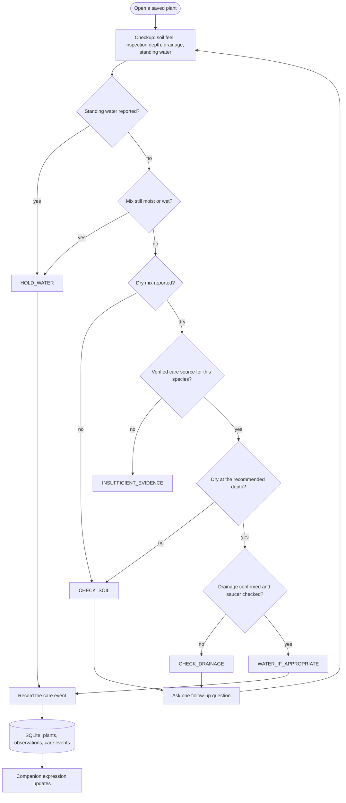
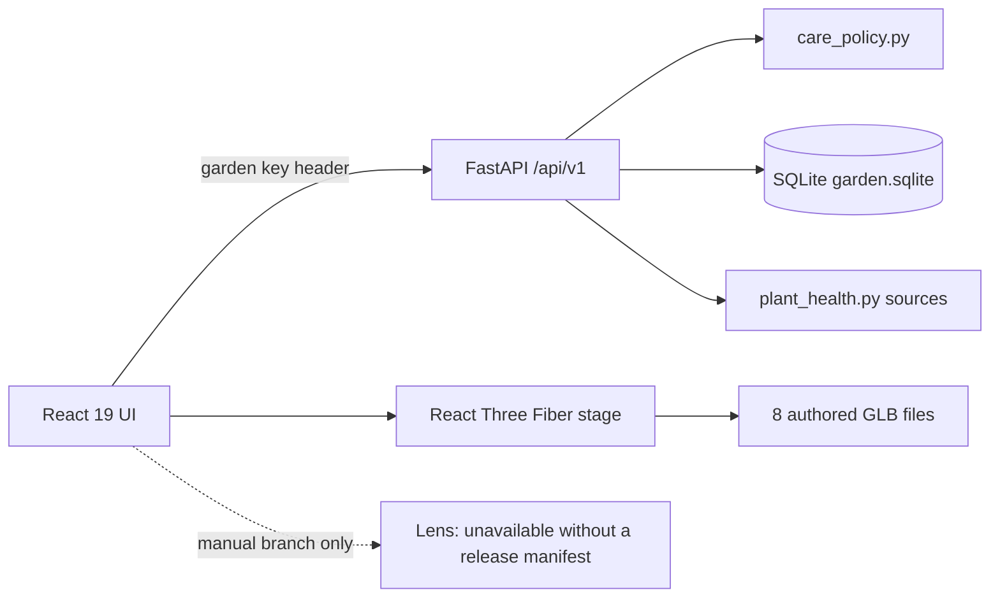
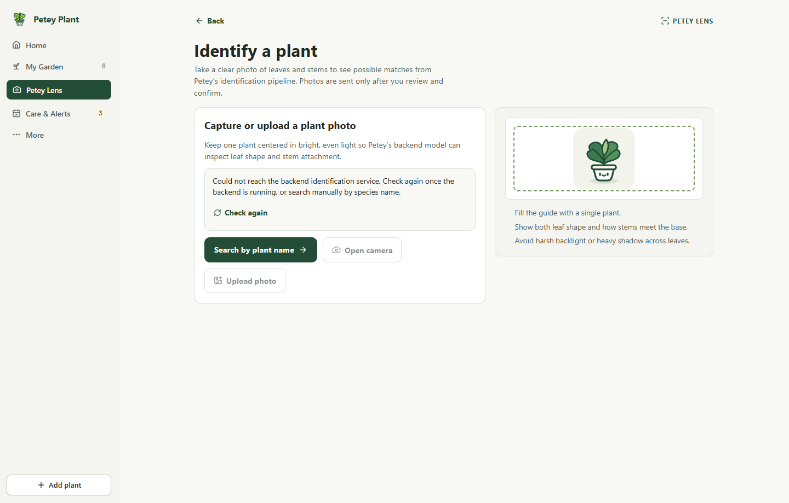
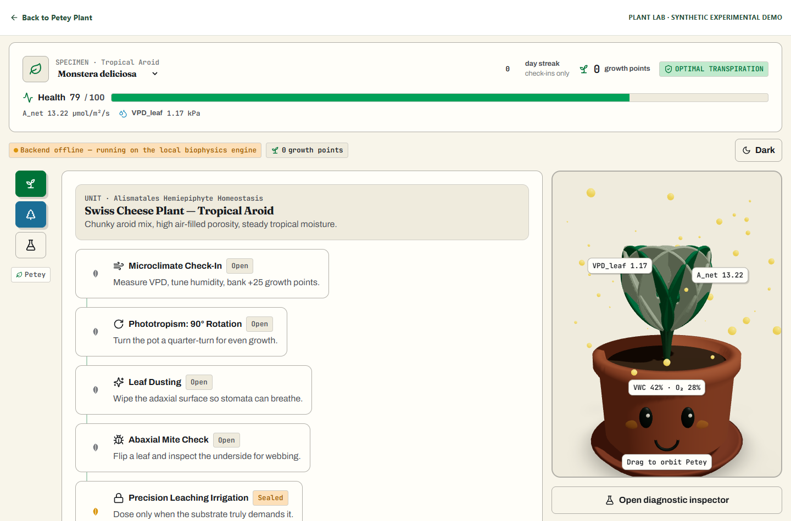
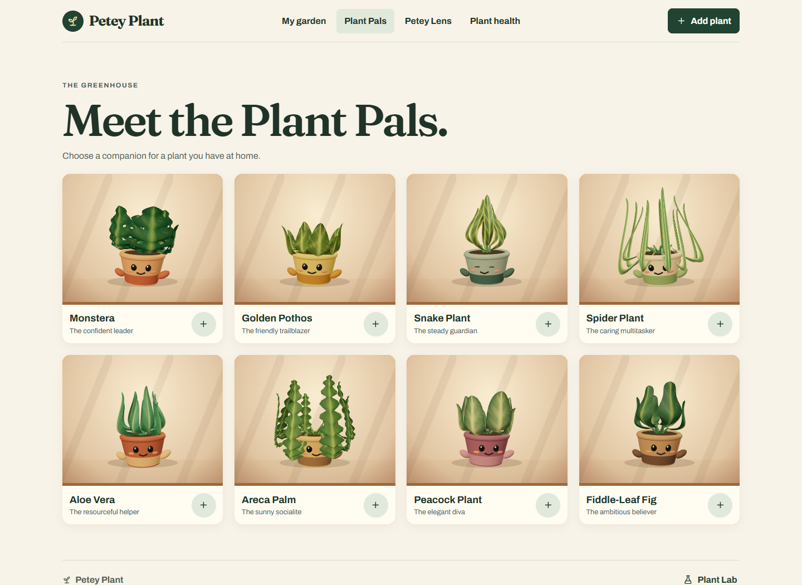

# Petey Plant

**A houseplant companion with living 3D botanical twins.** Petey helps busy people remember when to check the houseplants they already own, record what they actually observe, and get one next step that shows the evidence behind it. Fifty-eight Plant Pals authored in Blender 5.2 react to the care state you record, drawn by React Three Fiber on a single canvas.

[Walk through the workflows](docs/WORKFLOWS.md) · [Browse the Blender models](assets/characters/README.md) · [Read the Lens release gate](docs/FLIGHT_READINESS_REPORT.md) · [Follow Project Connect](docs/connect/MASTER_PLAN.md)

---



---

## What you can do today

| Screen | What is built and working |
|---|---|
| **Home** | One plant, one next action. A care surface states what the recorded observation supports, the estimated next check, and the current garden weather context. |
| **My Garden** | Save plants from 84 catalog identities, keep them in a hydration cart, and open any plant's profile with its care ledger and companion. The Blender roster covers 58 identities. |
| **Care & Alerts** | Prioritized care queue with acknowledgeable alerts, explicit "care schedule unavailable" and "nothing scheduled yet" states. No invented water volumes. |
| **Plant checkup** | Four physical questions — soil feel, inspection depth, drainage, standing water — resolved by a deterministic policy that refuses to recommend water without evidence. |
| **Plant Health** | A symptom and environment interview that returns source-cited, advisory next steps. It never writes to the saved garden record. |
| **Petey Lens** | Camera or gallery capture with client-side metadata stripping, manual species search and a confirmation step before a plant is saved. Automatic matching is unavailable (see the release gate). |
| **Plant Lab** | Separate experimental shell: terrarium canvas, growth ledger, diagnostic inspector and a local biophysics engine that runs when the backend is offline. All of its telemetry is synthetic. |

---

## The care loop

The backend decides, the browser only reports what the owner saw. `backend/services/care_policy.py` is a small ladder of refusals: it holds water first, then asks for the missing evidence, and only then allows a watering suggestion.



| Decision code | Meaning |
|---|---|
| `HOLD_WATER` | Standing water, or mix still moist/wet. Do not add water. |
| `CHECK_SOIL` | No fresh dry reading, or dryness was only measured at the surface. |
| `CHECK_DRAINAGE` | Drainage holes or the saucer were never confirmed. |
| `INSUFFICIENT_EVIDENCE` | The species has no verified watering policy in Petey. |
| `WATER_IF_APPROPRIATE` | Dry at the recommended depth, drainage confirmed, saucer checked. |

A checkup is valid for one hour (`CHECKUP_MAX_AGE`), and an assessment must be confirmed before it becomes a care record. Thirty-one Garden identities have verified watering guidance. Species without a verified source return `INSUFFICIENT_EVIDENCE`.



---

## Screens

### Plant profile and 3D stage

Every saved plant opens a profile with its companion on an orbit-controlled stage, its care ledger, and the next estimated check. The stage is one canvas: it detects WebGL2, guards render errors, restores a lost context, honours reduced motion, and falls back to a static 2D botanical card with the same accessible caption when 3D is unavailable.


### Guided checkup

The checkup asks only what a person can feel and see, then reports the decision and its source. Answering "I haven't checked" is a valid answer that produces a question, not a guess.


### Plant Health

Symptoms, environment and free-text notes become a triage result with citations to extension guidance. The dialog is advisory and leaves the garden record untouched.


### Petey Lens

Capture, crop and review work today. The species step is a manual search and confirmation; photo identification stays explicitly unavailable until the qualification gate passes.



### Plant Lab

A separate shell with a top telemetry bar, a growth ledger, one persistent terrarium canvas and a diagnostic sheet. Growth points come from biophysical check-ins, never from watering. The engine models VPD, moisture decay and a simplified Penman-Monteith proxy, and it keeps working offline.



### Responsive shell

The garden shell reflows from 320 px to 1440 px: a five-destination sidebar on desktop, a bottom navigation bar on mobile, and 32 weather atmosphere themes with six landscape archetypes behind the garden.

<p align="center">
  
</p>

---

## The eight flagship Plant Pals

Each companion has an editable Blender source, an exported GLB, a transparent WebP preview and a `spec.json` record. Counts below come from those records.

| Companion | Species | Persona | Clips | Triangles | GLB |
|---|---|---|---|---|---|
| Monstera | *Monstera deliciosa* | The confident leader | 8 | 39,594 | 1.10 MB |
| Golden Pothos | *Epipremnum aureum* | The friendly trailblazer | 6 | 16,038 | 0.41 MB |
| Snake Plant | *Dracaena trifasciata* | The steady guardian | 6 | 37,304 | 0.93 MB |
| Spider Plant | *Chlorophytum comosum* | The caring multitasker | 6 | 18,256 | 0.44 MB |
| Aloe Vera | *Aloe vera* | The resourceful helper | 6 | 17,084 | 0.39 MB |
| Fiddle-Leaf Fig | *Ficus lyrata* | The ambitious believer | 6 | 40,068 | 0.93 MB |
| Peacock Plant | *Goeppertia makoyana* | The elegant diva | 6 | 43,500 | 1.15 MB |
| Areca Palm | *Dypsis lutescens* | The sunny socialite | 6 | 45,956 | 0.93 MB |

257,800 triangles and 6.27 MB of GLB in total. Clip names are `Idle`, `Notice`, `Curious`, `Concerned`, `Relieved`, `Celebrate`, plus `Blink` and `Return to idle` on the Monstera. Care state maps to a mood, and the mood picks the clip: `Curious`, `Concerned` and `Relieved` override `Idle`, and a recorded care event plays `Celebrate`.



The eight flagships and 50 V5 additions are all registered in the app. The [shared model index](assets/characters/README.md) links every editable Blender master and its spec. Each spec records its GLB, WebP preview and owner review status. The registry holds camera framing and animation mappings. Owner visual approval is pending.

Loading is deliberate: a GLB is fetched on demand, cloned with `SkeletonUtils`, and the clone shares GPU geometry, materials and textures with its cached source. Failures degrade to the procedural companion, so a missing or blocked asset never blocks the care journey.

---

## How a companion is built

1. **Author** an editable `.blend` master under `assets/characters/<species>/source/`, using botanical references for silhouette and growth habit.
2. **Export** the runtime GLB and preview WebP, then record clips, triangle count and byte size in `spec.json`.
3. **Register** the species in the asset registry with its camera preset and clip map.
4. **Check** budgets, files and rendering with the verification scripts before review.

```bash
# Build and review a companion (Blender 5.2.2 LTS, background process)
blender -b --factory-startup --python-exit-code 1 -P tools/blender/build_monstera.py -- \
  --source assets/characters/monstera/source/monstera.blend \
  --glb frontend/public/characters/monstera-v3.glb \
  --renders artifacts/monstera

blender --disable-autoexec -b assets/characters/monstera/source/monstera.blend \
  --python-exit-code 1 -P tools/blender/review_monstera.py -- \
  artifacts/monstera --thumbnail frontend/public/characters/monstera-v3-preview.webp

# Audit the registry against the files on disk, then render the flagships and three expansion representatives in a browser
cd frontend
node verification/character-assets.mjs
node verification/characters.mjs
```

Each species has its own builder under `tools/blender/`. The full argument list and the per-species records live in [tools/blender/README.md](tools/blender/README.md).

---

## Architecture

```text
PeteyPlant/
├── assets/characters/<species>/     # Editable Blender source, spec.json, previews
├── backend/
│   ├── main.py                      # FastAPI app, health, legacy endpoints, SQLite
│   ├── services/garden.py           # Garden routes: plants, care, checkups, assessments
│   ├── services/care_policy.py      # Deterministic watering decisions
│   ├── services/plant_health.py     # Source-cited symptom triage
│   ├── services/lens.py             # Lens status and gated identify endpoint
│   ├── services/timeseries_vpd.py   # VPD, moisture decay, weather logic
│   └── tests/                       # 391 backend tests
├── frontend/
│   ├── src/components/garden/       # GardenApp, stage, checkup, health, Lens, alerts
│   ├── src/components/lab/          # Plant Lab shell
│   ├── src/lib/care/                # Client-side care projection
│   ├── src/lib/three/               # Asset registry, loader, shaders
│   └── verification/                # Playwright journeys, asset audits, contrast gate
├── tools/blender/                   # Per-species builders and review scripts
└── docs/                            # Workflows, release gate, screenshots
```

**Frontend:** React 19, TypeScript, React Three Fiber, Three.js, Vite, Tailwind, Framer Motion, Lucide.
**Backend:** FastAPI, Python 3.12+, Uvicorn, SQLite, Pydantic v2, NumPy.
**Art pipeline:** Blender 5.2.2 LTS masters, original geometry and authored keyframes, vertex-pigmented materials, GLB runtime exports.
**Verification:** Playwright journeys in Chromium or Edge, asset budget audits, WCAG contrast gate.

| Method | Path | Purpose |
|---|---|---|
| `GET` | `/health` | Service status |
| `GET` | `/api/v1/garden/species` | Catalog search |
| `GET` `POST` | `/api/v1/garden/plants` | List and create garden plants |
| `POST` | `/api/v1/garden/plants/{id}/care` | Record a care event |
| `GET` | `/api/v1/garden/plants/{id}/checkup` | Checkup context and prompt |
| `POST` | `/api/v1/garden/plants/{id}/assessments` | Run the care policy |
| `POST` | `/api/v1/garden/plants/{id}/assessments/{aid}/confirm` | Confirm an assessment |
| `POST` | `/api/v1/plant-health/triage` | Source-cited symptom triage |
| `GET` | `/api/v1/lens/status` | Lens availability |
| `POST` | `/api/v1/lens/identify` | Gated identification, unavailable without a release manifest |

Every garden request carries the browser's garden key in a header. The key is random and local: it isolates one browser's data, and clearing site data loses it. Production accounts, recovery and cross-device use are separate work.

---

## Run it

```bash
# Terminal 1 - backend on http://localhost:8000
cd backend
python -m uvicorn main:app --port 8000

# Terminal 2 - frontend on http://localhost:3000
cd frontend
npm ci
npm run dev
```

The Vite dev server proxies `/api/v1/*` to FastAPI on the same origin, so the browser never makes a cross-origin call. Point `PETEY_GARDEN_DB` at another SQLite file to keep test data separate from `backend/garden.sqlite`.

---

## Verification

```bash
cd backend && python -m pytest -q                 # 391 tests
cd ../frontend && npm run build                   # tsc --noEmit && vite build
npm run verify:contrast                           # WCAG AA contrast gate

# With both services running and Playwright Chromium installed
node verification/garden.mjs                      # garden journey + 320-1440 layouts
node verification/character-assets.mjs            # asset budgets, clips, files
node verification/characters.mjs                  # renders flagships and expansion examples
node verification/plant-tools.mjs                 # checkup and health tools
node verification/screenshot.mjs                  # 320/768/1440 screenshots
```

Set `PETEY_BROWSER_CHANNEL=msedge` to run the journeys in an installed Edge instead of the bundled Chromium. `node tools/capture_showcase.mjs` regenerates the screenshots in `docs/images/`.

Use the [verification map](docs/connect/ENGINEERING_INTEGRITY.md#journey-and-release-verification) to find the checks for each feature. The [engineering improvement playbook](docs/connect/SELF_IMPROVEMENT.md) explains how contributors and agents reproduce failures and prevent them from recurring. See the [milestone log](PLANS.md) for measured results and the [Antigravity handoff](ANTIGRAVITY_HANDOFF.md) for open work.

---

## Honest limits

- **Lens is NO-GO.** `docs/FLIGHT_READINESS_REPORT.md` records every suite as incomplete or unavailable. The runtime returns `unavailable` without a release manifest, and the app offers manual species search instead. No accuracy number is claimed for photo identification.
- **Care dates are estimates.** Next-check dates are follow-up suggestions derived from the last recorded observation. They are never moisture readings, sensor values or an automatic watering schedule.
- **Verified guidance is narrow.** 31 of the 79 catalog species carry cited qualitative care data, and only Monstera and golden pothos have an actionable watering policy. Everything else asks for evidence rather than guessing.
- **Plant Lab is synthetic.** Its telemetry, sensor walks and growth curves are generated to exercise the biophysics model, and they are labelled as such in the app.
- **Reminders are preferences, not delivery.** Quiet hours and notification choices are stored locally; the app requests permission but does not run a scheduler.
- **Open issues are tracked.** `PLANS.md` lists the current gaps, including duplicate care events on a retried write, client-side recommendation staleness in a long-open tab, and missing listbox focus behaviour in the plant switcher.
- **No physical device, screen reader or deployment has been tested.** Browser verification ran in desktop Chromium and emulated mobile widths.

Petey stores plants in local SQLite and the garden key in browser storage. Lens images are processed in memory and are not retained or used as training data. Sitter access tokens are demo-grade and in-memory.

---

## Working on Petey with OpenCode

The repository's agent skills are available as slash commands, so a workflow can be invoked directly:

```text
/blender-asset-qa        # mesh and asset review gate before calling a model done
/blender-export-pipelines # verified GLB export presets and post-export checks
/ui-ux-pro-max           # layout and interaction guidance for the garden UI
/systematic-debugging    # isolate a root cause before touching code
```

Use `@skill-id` when a skill is not present as a command. Regenerate the command files after adding a skill, since commands are static.

---

## License and acknowledgements

Petey Plant is licensed under the MIT License. See [LICENSE](LICENSE) for details. Special thanks to the extension horticultural programs at NC State, Missouri Botanical Garden, RHS, UF/IFAS and University of Maryland Extension for the published plant care methodologies cited in the app.
