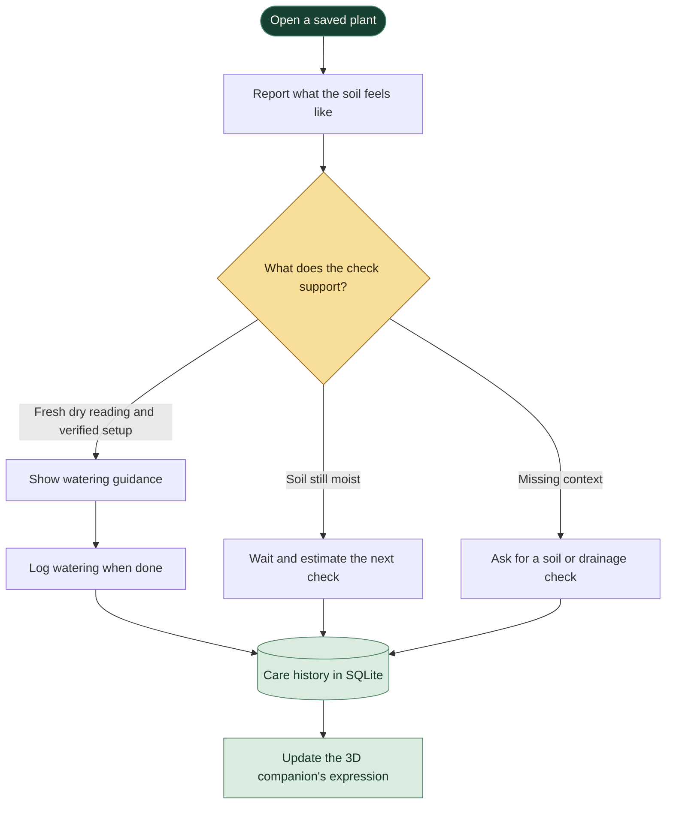
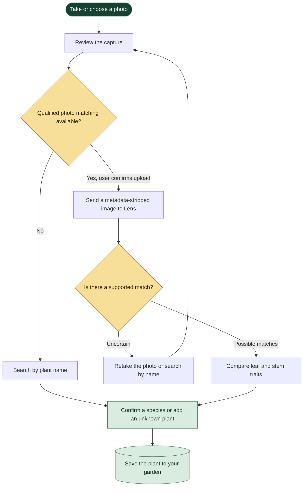
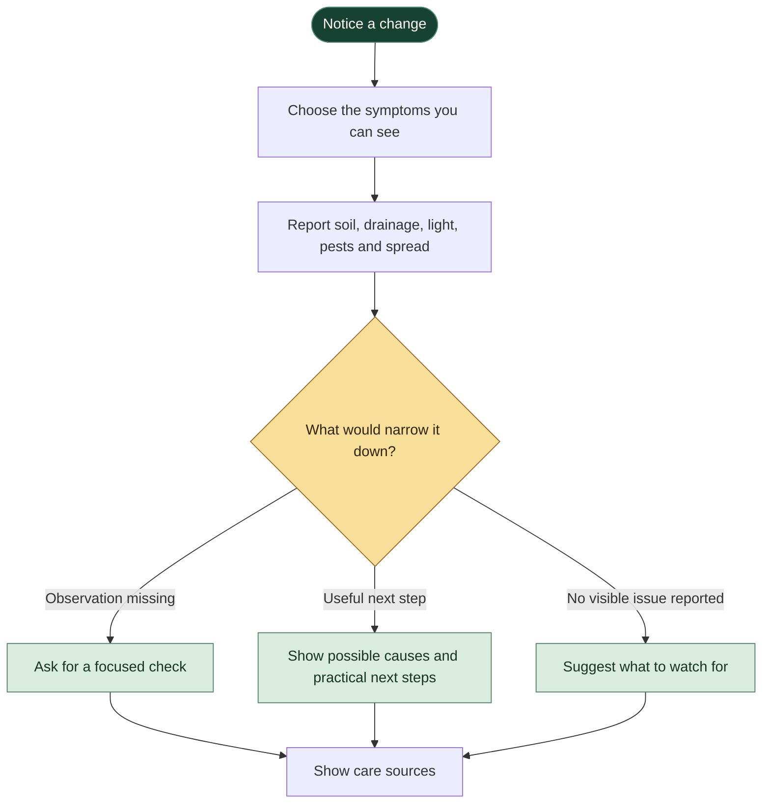
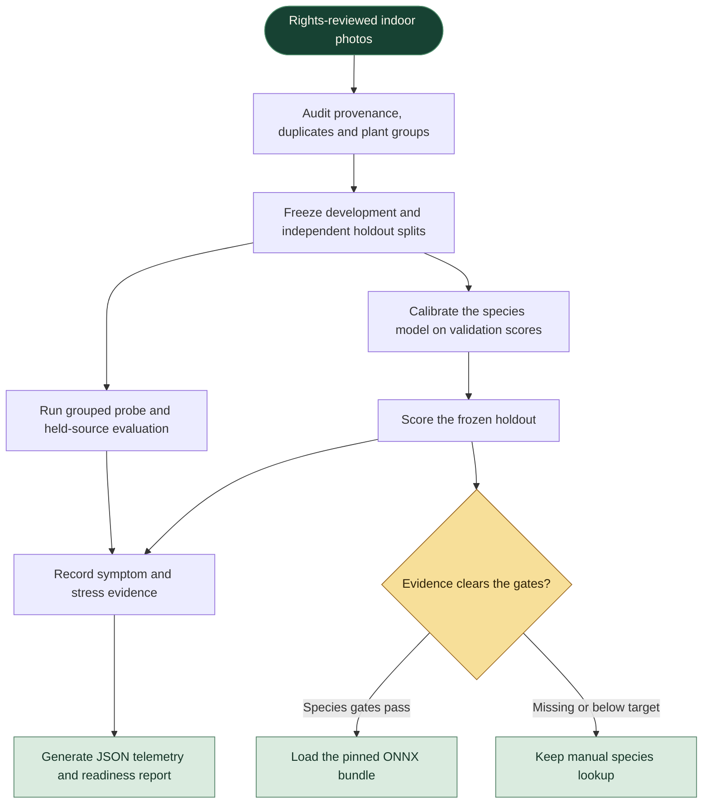

# How Petey Plant works

[Back to the project](../README.md) · [Plant Pals gallery](images/petey-live-plant-pals.png) · [Model readiness](FLIGHT_READINESS_REPORT.md)

Petey has three everyday jobs. Help someone care for a plant they own, help them work out what they are seeing, and let them confirm a species before saving it. The diagrams follow the app and its offline model workflow.

## 01 · Care for a plant you own

The browser holds the key to its local garden. Next-check dates are estimates. Observation-led watering guidance currently covers Monstera and golden pothos, with confirmed pot drainage and a fresh soil report.

## 02 · Identify a plant with Petey Lens

The current build follows the manual lookup branch. If a matching model qualifies, its suggested species still needs your confirmation. The Lens service processes uploads in memory. It does not use them as training data.

## 03 · Work through a plant health concern

Triage uses your observations and can give different next steps for similar-looking leaves. For example, wilting with unknown soil moisture calls for a soil check, while wilting with wet soil calls for holding off on watering and checking drainage. Triage observations are separate from saved garden records.

## 04 · Qualify a photo matching model

The offline tools can audit photo manifests, run the grouped probe, score a local artifact, and generate readiness reports. The current status is **NO-GO** while independent indoor evaluation and a qualifying model are pending. See the [runtime contract](../backend/LENS.md), [offline commands](../backend/lens_pipeline/README.md), and [measured readiness results](FLIGHT_READINESS_REPORT.md).

## Where to find the implementation

| Area | Start here |
| --- | --- |
| Garden, Lens, Plant Health, and 3D companions | [Garden frontend](../frontend/src/components/garden/) |
| Saved plants and care history | [Garden service](../backend/services/garden.py) |
| Owner-observation triage | [Plant Health service](../backend/services/plant_health.py) |
| Photo matching and model loading | [Lens API](../backend/services/lens.py) and [ONNX adapter](../backend/services/lens_model.py) |
| Audits, evaluation, and readiness | [Offline pipeline](../backend/lens_pipeline/) |
| Browser checks | [Garden](../frontend/verification/garden.mjs) and [Lens and Plant Health](../frontend/verification/plant-tools.mjs) |
